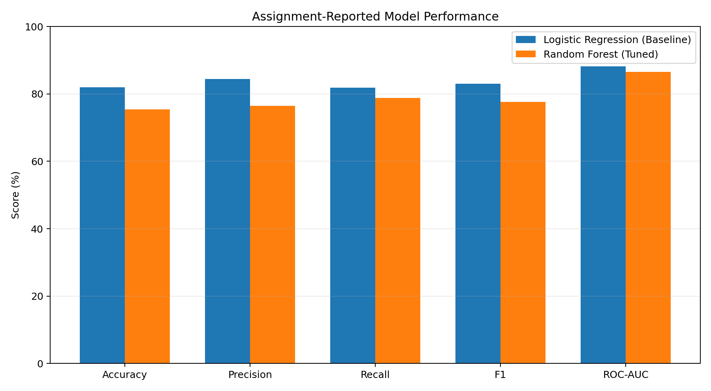

# Cardiovascular Disease Prediction Using Machine Learning

An academic machine-learning project exploring cardiovascular disease prediction with a strong focus on **data integrity, reproducibility, evaluation and responsible AI**.

This repository was rebuilt from my COM747 Data Science and Machine Learning coursework code so the project can be shared as a clean, reproducible portfolio project.

> **Important:** This is an educational project. It is not a medical device and must not be used for diagnosis or clinical decision-making.

## What the project does

The original coursework used a 1,025-row heart-disease dataset with 13 input features and one binary target. The workflow:

1. checks the dataset schema and missing values;
2. identifies and removes exact duplicate records;
3. analyses feature relationships and demographic representation;
4. handles extreme values using IQR clipping;
5. splits the data into stratified train/test sets;
6. handles target-class imbalance using SMOTE;
7. trains an interpretable Logistic Regression baseline;
8. tunes a Random Forest using GridSearchCV;
9. evaluates accuracy, precision, recall, F1, ROC-AUC and PR-AUC;
10. reports descriptive group metrics by recorded sex;
11. saves plots, metrics and trained model artifacts.

## Why there are two implementations

The uploaded coursework PDF contains real Python code, including data loading, preprocessing, SMOTE, Logistic Regression, Random Forest tuning and evaluation.

For this public portfolio repository I kept two versions:

- **`src/legacy_assignment_reconstruction.py`** — a cleaned reconstruction of the submitted workflow.
- **`src/train.py`** — a stronger leakage-aware implementation where train-fitted preprocessing and SMOTE run inside model pipelines.

The reasoning behind those changes is documented in [`docs/source_notes.md`](docs/source_notes.md).

## Reported coursework results

These values are transcribed from the submitted code output and have not been relabelled as newly reproduced results.

| Model | Accuracy | Precision | Recall | F1 | ROC-AUC |
|---|---:|---:|---:|---:|---:|
| Logistic Regression | 81.97% | 84.38% | 81.82% | 83.08% | 88.20% |
| Tuned Random Forest | 75.41% | 76.47% | 78.79% | 77.61% | 86.53% |

The original output also reported:

- **1,025** initial rows
- **723** exact duplicate records
- **302** unique rows after deduplication
- Logistic Regression 5-fold CV recall: **87.81% ± 7.80%**
- Random Forest best parameters:
  - `n_estimators=200`
  - `max_depth=15`
  - `min_samples_split=2`
  - `min_samples_leaf=1`

A final sentence in the original code export said Random Forest improved accuracy and precision, but the displayed metrics show Logistic Regression was higher on all reported test metrics. This repository keeps the numerical results and documents that inconsistency rather than repeating it.



## Responsible-AI note

The original coursework used SMOTE while discussing fairness. In this portfolio version, I separate two different ideas:

- **SMOTE** is used to address target-class imbalance.
- **Fairness analysis** is handled separately through group-wise descriptive metrics such as predicted-positive rate, TPR/recall, FPR and precision.

Balancing classes does not automatically make a model fair across demographic groups.

See [`docs/ethics_and_limitations.md`](docs/ethics_and_limitations.md).

## Dataset

The project expects the common 1,025-row `heart.csv` format with these columns:

```text
age, sex, cp, trestbps, chol, fbs, restecg,
thalach, exang, oldpeak, slope, ca, thal, target
```

The original coursework used a Kaggle/UCI-derived version of the Heart Disease dataset. To keep dataset provenance separate from the code, this repository includes a one-command downloader rather than claiming ownership of the raw data.

```bash
python scripts/download_dataset.py
```

The script saves the file as:

```text
data/heart_data.csv
```

Dataset background: UCI Heart Disease, DOI `10.24432/C52P4X`.

More details: [`data/README.md`](data/README.md).

## Project structure

```text
cardiovascular-disease-ml-crispdm/
├── assets/
│   ├── assignment_logistic_confusion_matrix.png
│   ├── assignment_model_comparison.png
│   └── project_pipeline.png
├── data/
│   └── README.md
├── docs/
│   ├── ethics_and_limitations.md
│   └── source_notes.md
├── notebooks/
│   └── cardiovascular_disease_prediction.ipynb
├── results/
│   ├── ASSIGNMENT_RESULTS.md
│   └── assignment_reported_metrics.csv
├── scripts/
│   ├── download_dataset.py
│   └── run_project.py
├── src/
│   ├── data.py
│   ├── evaluation.py
│   ├── legacy_assignment_reconstruction.py
│   └── train.py
├── tests/
│   ├── test_data.py
│   └── test_pipeline.py
├── CONTRIBUTORS.md
├── CITATION.cff
├── LICENSE
├── LINKEDIN_PROJECT_ENTRY.md
├── GITHUB_UPLOAD_GUIDE.md
├── README.md
└── requirements.txt
```

## Quick start

### 1. Create an environment

```bash
python -m venv .venv
```

Windows:

```bash
.venv\Scripts\activate
```

macOS/Linux:

```bash
source .venv/bin/activate
```

### 2. Install dependencies

```bash
pip install -r requirements.txt
```

### 3. Download the dataset and run the improved pipeline

```bash
python scripts/run_project.py
```

That command downloads the dataset if needed and writes fresh outputs to `results/reproduced/`.

### 4. Run tests

```bash
pytest
```

## Main tools

- Python
- pandas / NumPy
- scikit-learn
- imbalanced-learn
- Matplotlib / Seaborn
- Logistic Regression
- Random Forest
- GridSearchCV
- Stratified K-Fold Cross-Validation
- SMOTE
- CRISP-DM concepts

## Academic project context

This was a **group academic project** completed at Ulster University. The report authors are acknowledged in [`CONTRIBUTORS.md`](CONTRIBUTORS.md). Student IDs and university email addresses have deliberately been left out of this public repository.

## Limitations

This dataset is small, contains repeated records in the popular 1,025-row version, and is not representative enough for real clinical deployment. Reported results should be interpreted as educational benchmark results only.

## License

The code in this repository is released under the MIT License. Dataset rights and attribution remain with the original dataset creators/distributors.
